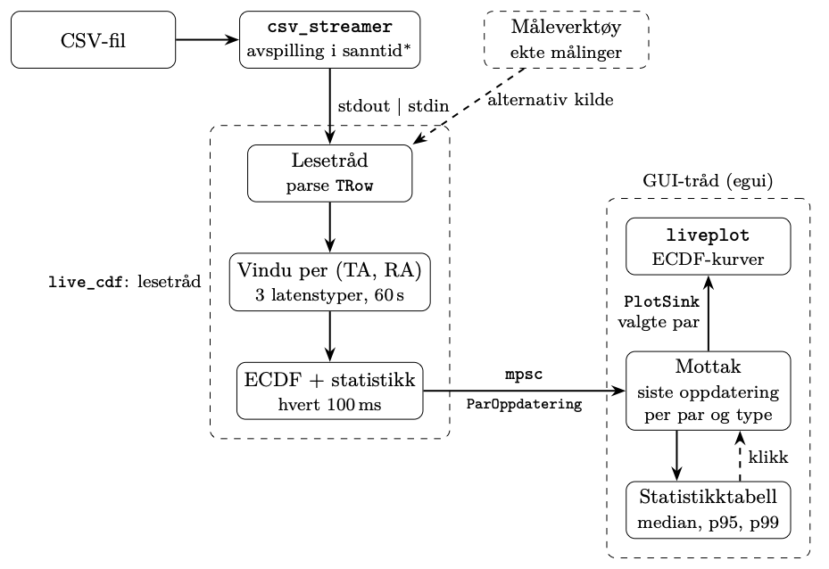

# Live CDF av latens i Wi-Fi

Denne oppgaven bygger på prosjektet til veilederen min, som måler ulike latenstider i et datanettverk. Resultatet er en linje med målinger per ramme. Da det kan komme mange målinger i sekundet er det vanskelig å få et bilde av hvordan nettverket oppfører seg til enhver tid gjennom en visning i terminalen. Det trengs derfor et verktøy som kan vise frem målingene grafisk mens de kommer inn. Prosjektet er også skrevet i programmeringsspråket Rust som er det samme som veilederen min har brukt til måleprogrammet. Derfor har jeg laget et program som viser en CDF og statistikk for rammer som er på datanettverket.

Hele rapporten ligger i [`thesis/IN3260_Vegard_Myklebust.pdf`](thesis/IN3260_Vegard_Myklebust.pdf).

## Oppbygging



Under testing spilles data av fra fil av `csv_streamer`; i bruk kan måleverktøyet sende data direkte (stiplet). Dataen sendes gjennom en pipe til `live_cdf`, der en lesetråd beregner ECDF og statistikk og sender resultatet til GUI-tråden.

\* Radene sendes med samme tidsavstand som mellom pakkene i CSV-filen (differansen i `first_seen_pcap_ts`).

## Bygging

```sh
cargo build --release
```

## Kjøring

Med testdata:

```
./target/release/csv_streamer <testdata.csv> | ./target/release/live_cdf
```

Med ekte data 
```
MÅLEVERKTØY | ./target/release/live_cdf
```

## Inputformat

CSV med header-rad. "header= true" i reader.rs